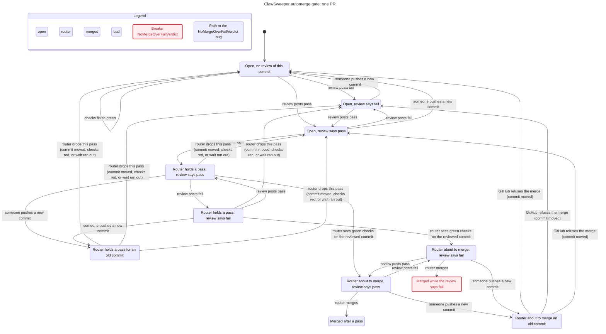

# PR automerge gate — formal model (Forge pilot cs-sm-pilot-1109)

Agent instructions: [`.agents/skills/verify-pr-automerge-gate/SKILL.md`](../../.agents/skills/verify-pr-automerge-gate/SKILL.md).

## Property

**ClawSweeper merges a PR only when the current ClawSweeper verdict for the exact merged commit is pass.**

- Part 1, `MergedCommitWasReviewed` — holds. `--match-head-commit` in `buildAutomergeMergeArgs` carries it; the router's stale-head checks are a second layer.
- Part 2, `NoMergeOverFailVerdict` — **breaks (finding F1)**.

## Finding F1 (candidate bug, not patched)

The router can merge a commit after ClawSweeper's review of that same commit changed from pass to needs-changes.

1. Review posts pass for commit H; checks are green.
2. The comment router picks up the pass and holds `expected_head_sha = H`.
3. A re-review (`/clawsweeper re-review` or scheduled) edits the review to needs-changes for H. The review lane runs in a different concurrency group from the router.
4. `executeAutomerge` re-reads the PR view only: head is still H, checks green.
5. `gh pr merge --match-head-commit H` succeeds.

Evidence:

- TLC: shortest path above, 6 steps, 68 distinct states (MaxHead = 2).
- Replay: `replay-f1.test.mjs` FLIP variant runs the real `dist/repair/comment-router.js` with a stub `gh`. The comment flips before the `executeAutomerge` PR view; the router still calls `gh pr merge`. CONTROL merges; PRE-FLIPPED does not.
- Not reproduced live on GitHub (out of scope: no merges).

Model experiment: re-reading the verdict inside `validateAutomergeReadiness` (`RecheckVerdictBeforeMerge = TRUE`) shrinks the window but the rule still breaks between the readiness check and the merge call. A fix needs the review lane and the router to agree on the verdict at merge time (for example a lock, or a fail verdict that also removes merge eligibility the router re-checks atomically). That is a design decision for Luke; no product change was made.

## Able to fail

Scratch break in the real code: delete the `--match-head-commit` push in `buildAutomergeMergeArgs` (`src/repair/comment-router-core.ts`). `check.sh` then derives `MatchHeadOnMerge = FALSE` and exits 1 with `NEW VIOLATION: MergedCommitWasReviewed` (path: router clears the merge for H → someone pushes H2 → router merges H2). Break reverted; check back to exit 0 with only F1.

## Chart (sync commit d598b09bba)

States in pink are a merge that breaks the property. Hidden: the `Done` stutter step only.

## Files

| File                      | Role                                                                            |
| ------------------------- | ------------------------------------------------------------------------------- |
| `PrAutomergeGate.tla`     | TLA+ model; each action names its code                                          |
| `derive-guards.mjs`       | reads guard constants from the code, prints the TLC config                      |
| `check.sh`                | one-command check (build, derive, TLC, compare with expected)                   |
| `expected-violations.txt` | known findings (F1)                                                             |
| `view.mjs`                | reader's words for `/statechart`                                                |
| `chart.mmd`               | chart at the sync commit                                                        |
| `replay-f1.test.mjs`      | replay of F1 on the real router with a stub `gh` (evidence; not in `pnpm test`) |

Bounds: one PR, 2 head commits, verdicts pass/fail, TLC 1.7.4, 1 worker, ~10 s. See the skill for what the model leaves out.
